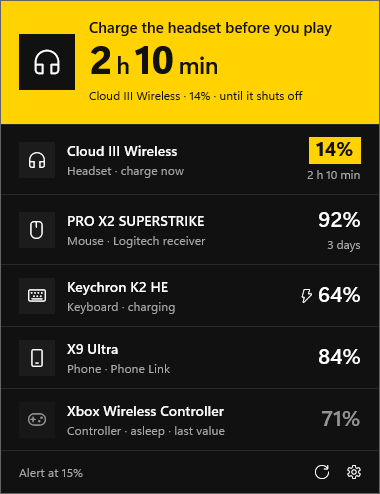
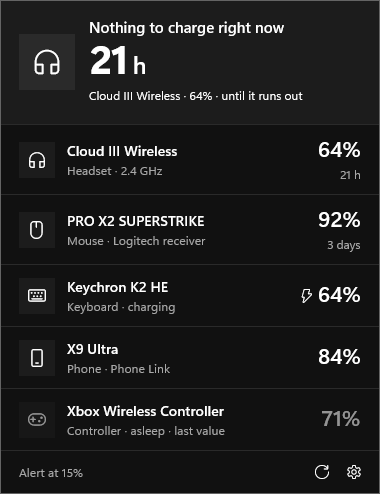
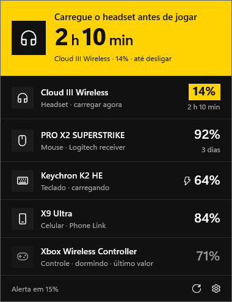

# BatteryLife

**Your wireless gear's battery, read like an airport sign.**

BatteryLife sits in the Windows 11 tray and answers one question at a glance: *what do I need to charge, and how long do I have?* The panel stays calm and black while everything is fine and turns signal yellow only when something needs charging, with the time left in big numbers.

[](https://github.com/joshsegatt/BatteryLife/actions/workflows/ci.yml)
[](LICENSE)

[](https://github.com/joshsegatt/BatteryLife/issues/new)

<p>
  
  &nbsp;&nbsp;
  
</p>

<sub>Screenshots use the app's built-in demo data (`BatteryLife.exe --demo`), not real readings. The UI follows the Windows display language (English or Portuguese); `--lang en` forces one.</sub>

## Why another battery app

Most battery widgets show a row of equal numbers and leave the thinking to you. BatteryLife does the thinking:

- **One decision, not a dashboard.** The band names the device that runs out first and how long it has left. Yellow means "act now" and is used for nothing else, so a yellow tray icon always means something needs you.
- **Time left, not just a percentage.** The core learns each device's drain while you use it and turns "18%" into "2 h 10 min until it shuts off".
- **Alerts that don't nag.** A notification fires once when a device crosses 15%, and again only after it has charged.
- **Built to stay out of the way.** Sleeping devices keep their last value (dimmed) instead of vanishing, and a crashed driver can never take the app down.

## Features

- Tray icon with the level of the device that runs out first, yellow only when it needs charging
- Hub panel in the airport-sign design: next action, every device, charging state, time left
- Estimated time left from observed drain (needs about 20 minutes of history)
- Low-battery notification at 15%, with no repeats while the level hovers
- Read-only: BatteryLife only asks devices for their battery and never changes a setting
- Windows contrast themes, the "animation effects" setting, keyboard (Esc closes), screen readers
- Portuguese (Brazil) and English, following the Windows display language
- Start with Windows, native right-click menu, no account, no network access

## Supported devices

The device protocols come from the community-built [BatteryHub](https://github.com/krisgfx9/Wireless-Device-Battery-Monitor) project, ported to Rust with its byte-for-byte tests: **77 brand drivers, 4 generic readers and 378 tests**.

| Kind | Brands (selection) |
|---|---|
| Mice | Logitech (HID++), Razer, SteelSeries, Corsair, Glorious, Pulsar, LAMZU, VGN, Finalmouse, WLMouse, VAXEE, Ninjutso, Scyrox, Endgame Gear, ZOWIE, RAWM, Kysona / VXE, ATK, Rapoo, MSI, ROG, Cooler Master, MCHOSE, Ajazz, Darmoshark, Fantech |
| Headsets | Logitech G, HyperX, SteelSeries Arctis Nova Elite, Razer BlackShark / Barracuda, ASTRO, Audeze, Jabra, JBL Quantum, Poly, Turtle Beach, AKG, Sony INZONE, Fractal, ENDORFY, Alienware |
| Keyboards | Keychron, Royal Kludge, NuPhy, Akko, AULA, Cherry, ATK / VGN, SONiX, PMO, Machenike, Redragon, DAREU, DARKRIM |
| Any brand | Bluetooth devices Windows already reads, HID devices with a standard battery report, Xbox controllers |
| Phone | The phone linked in Microsoft Phone Link (when Phone Link shows its battery) |

**Honest status:** the Logitech driver and Phone Link are verified on real hardware. The other drivers are faithful ports with passing tests but have not been tried on a device yet. If yours works (or doesn't), please [open an issue](https://github.com/joshsegatt/BatteryLife/issues/new): every report moves a driver from "ported" to "verified".

## How it compares with BatteryHub

BatteryHub is the project whose device research made BatteryLife possible, and it is excellent. Pick by what you value:

| | BatteryLife | BatteryHub |
|---|---|---|
| Main idea | Tells you the next thing to charge and the time left | Shows every level on the taskbar |
| Where it shows | Tray icon + hub panel (official Windows APIs) | Text strip injected into the taskbar, always visible |
| Time-left estimate | In the panel and the notification | In the history viewer |
| Battery history chart | Not yet | Yes (24 h / 7 d / 30 d) |
| Device coverage | 77 brand drivers ported, most not yet hardware-verified | About 100 drivers, many hardware-verified |
| Crash isolation | Drivers run in a separate process, in parallel, each with a deadline | One process, drivers polled in sequence |
| Memory safety | Device parsing in Rust | C++ |
| Size and memory | Core about 1 MB of RAM; the WinUI app about 90 MB of RAM, a 95 MB download (240 MB unzipped, .NET included) | About 2 MB of RAM, about 350 KB |
| Languages | 2 | 19 |
| Signed auto-updates | Not yet | Yes |
| Linux | No | Experimental |

## Install

1. Download `BatteryLife-<version>-win-x64.zip` from the [latest release](https://github.com/joshsegatt/BatteryLife/releases/latest). It runs on Windows 11 x64 with nothing else to install: the .NET runtime ships inside.
2. Extract it to a folder that will stay put, for example `%LOCALAPPDATA%\BatteryLife` (the "Start with Windows" option points to this folder).
3. Run `BatteryLife.exe`. The release is not code-signed yet, so Windows SmartScreen may say *Windows protected your PC*: click **More info**, then **Run anyway**. You can check the download against the `.sha256` file next to it in the release.

To uninstall, turn off **Start with Windows** in the tray menu, quit, and delete the folder.

### Build from source

1. Install [Rust](https://rustup.rs/) and the [.NET 10 SDK](https://dotnet.microsoft.com/download).
2. Build the device reader:

   ```powershell
   cd core
   cargo build --release
   ```

3. Build and run the app, which copies the reader next to itself:

   ```powershell
   cd app
   dotnet build BatteryLife.App -c Release -r win-x64 -p:Platform=x64
   ```

   Then run `app/BatteryLife.App/bin/x64/Release/net10.0-windows10.0.22621.0/win-x64/BatteryLife.exe`.

Windows puts new tray icons behind the **^** arrow. On first launch BatteryLife shows a notification with a **Pin to taskbar** button. You can also drag the icon from the **^** area onto the taskbar.

The reader also works on its own: `batterylife-core --list`, `--json`, or `--watch [seconds]` for one JSON line per poll.

## How it works

```
BatteryLife.exe (C#, WinUI 3)            batterylife-core.exe (Rust)
 tray icon, panel, alerts   <-- JSON --   registry -> drivers in parallel -> tracker
                            -- refresh ->  (HID, Bluetooth, Xbox, Phone Link)
```

- **Registry:** each driver declares the devices it handles. An exact product id beats a whole-vendor match, so no fragile ordering is needed.
- **Parallel polling:** drivers run in parallel, each with a deadline, so one stuck device never delays the others. A product its brand driver doesn't recognise falls back to the standard HID battery report.
- **Tracker:** keeps a sleeping device's last value for a grace period and estimates time left from the drain it observes.
- **Separate processes:** the app runs the core as a child process and restarts it if it ever exits.

Design decisions live in [`PRODUCT.md`](PRODUCT.md) and [`DESIGN.md`](DESIGN.md).

## Help wanted

- **Test with your hardware:** extract the release zip (see [Install](#install)), run `batterylife-core.exe --list` from its folder in a terminal and tell us what it shows. This is the most valuable contribution right now.
- **Report a device we don't read:** [open an issue](https://github.com/joshsegatt/BatteryLife/issues/new) with the output of `batterylife-core --list` and the device name.
- **Translate:** all text lives in [`app/BatteryLife.Logic/Text.cs`](app/BatteryLife.Logic/Text.cs).
- **Code:** read [`CLAUDE.md`](CLAUDE.md) for the layout and the checks CI runs. Open a pull request with one change at a time.

## Support the project

If BatteryLife saves you from a dead headset mid-match:

- ⭐ **Star the repo.** It helps other gamers find it.
- 💛 **Donate:** [](https://www.paypal.com/donate/?business=segatt22%40gmail.com&item_name=BatteryLife) Donations pay for test hardware, so more drivers move from "ported" to "verified".
- Share it with your squad or your favourite peripheral subreddit.
- Want to sponsor development or lend hardware for testing? Open an issue and we'll talk.

## Credits and license

Device protocols are ported from [BatteryHub](https://github.com/krisgfx9/Wireless-Device-Battery-Monitor) by krisgfx9 and contributors (GPL-3.0), which in turn credits Solaar, HeadsetControl and OpenRazer. Every ported file names its source; see [`CREDITS.md`](CREDITS.md).

BatteryLife is free software under the [GNU General Public License v3.0](LICENSE).

---

### Em português

O BatteryLife mostra, na bandeja do Windows 11, qual aparelho sem fio vai acabar primeiro e quanto tempo ele ainda tem. A faixa fica preta e calma quando está tudo bem e amarela só quando algo precisa carregar. Ele lê mouses, headsets, teclados, controles e o celular (pelo Phone Link), e nunca muda configuração nenhuma do aparelho. Para instalar, baixe o zip da [última versão](https://github.com/joshsegatt/BatteryLife/releases/latest), extraia numa pasta fixa e abra o `BatteryLife.exe` (se o Windows avisar, clique em "Mais informações" e "Executar assim mesmo": o app ainda não tem assinatura digital). Achou um aparelho que não aparece? [Abra uma issue](https://github.com/joshsegatt/BatteryLife/issues/new). Quer apoiar? [Doe pelo PayPal](https://www.paypal.com/donate/?business=segatt22%40gmail.com&item_name=BatteryLife): as doações compram aparelhos para testar os drivers.


